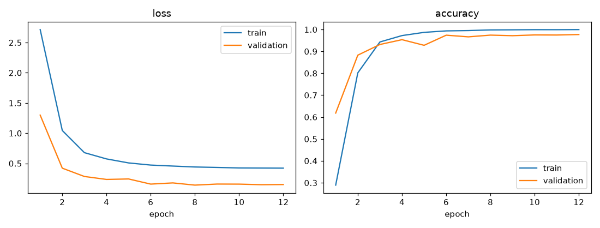
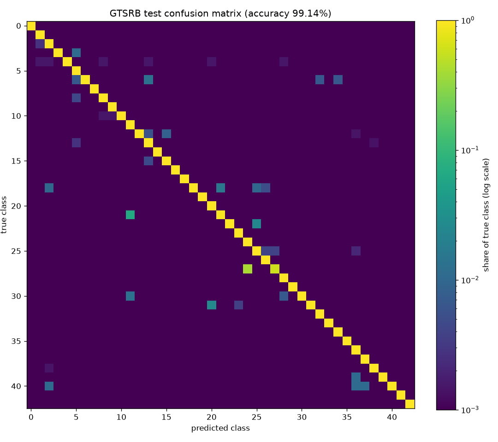
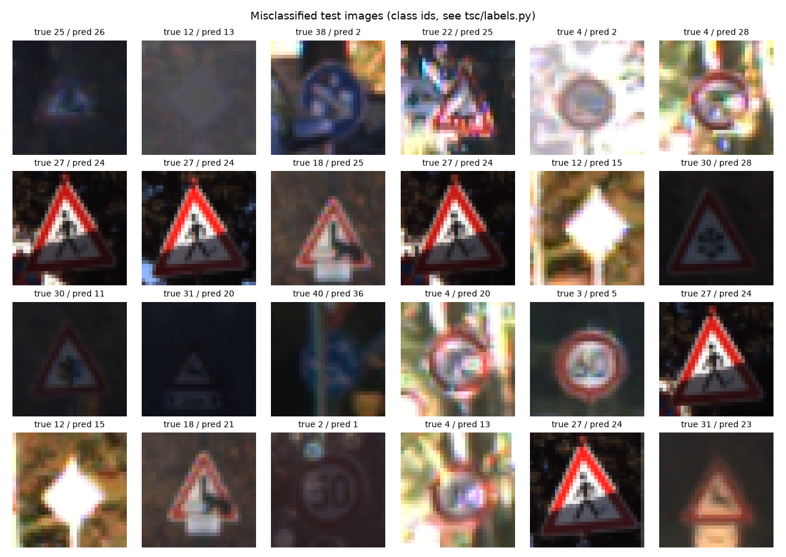

# Traffic Sign Classification (GTSRB) with a CNN in PyTorch

A small convolutional network trained from scratch on the
[German Traffic Sign Recognition Benchmark](https://benchmark.ini.rub.de/gtsrb_news.html) (43 classes),
CPU only. Traffic-sign recognition is a standard perception task in driver-assistance systems.

**Test accuracy: 99.14% on the official 12,630-image test set** (macro F1 0.983), 823k parameters,
0.75 ms per image on a laptop CPU.



## Approach

| Part | Choice | Why |
|---|---|---|
| Input | images resized to 32×32 RGB, normalized with the training-set mean/std | signs in GTSRB are 15–250 px; 32×32 keeps them recognizable and training fast on CPU |
| Validation split | 10% of **tracks**, not 10% of images | each track is ~30 consecutive frames of the same physical sign; a random image split puts near-duplicates in train and validation and overstates accuracy |
| Model | 3 blocks of [conv3×3-BN-ReLU ×2 → max-pool], 32/64/128 channels, then dropout → FC 256 → FC 43 | VGG-style stack: small kernels, BatchNorm for stable training, pooling halves the size 32→16→8→4 |
| Augmentation | random rotation ±10°, shift ±10%, scale 0.9–1.1, brightness/contrast/saturation ±30% | simulates camera angle and lighting changes. **No horizontal flip**: it turns "turn left" into "turn right" |
| Training | AdamW (lr 3e-3, weight decay 1e-4), one-cycle LR schedule, label smoothing 0.05, batch 128, 12 epochs | one-cycle warms up then anneals the learning rate, converging in few epochs |
| Model selection | checkpoint with the best validation accuracy | the test set is used once, at the end |

## Results

| Metric | Value |
|---|---|
| Test accuracy (12,630 images) | **99.14%** (108 errors) |
| Macro F1 (all 43 classes weighted equally) | 0.9825 |
| Best validation accuracy (split by track) | 97.69% (epoch 12) |
| CPU inference, batch 512 | 0.747 ms per image |

Validation accuracy (97.7%) is lower than test accuracy (99.1%). The 2,640 validation images come from only
~88 tracks, so one hard track (30 frames of a dark or blurred sign) moves the number by about 1%; the test set
has 12,630 images and is the more reliable estimate.

The training loss stays around 0.42 while validation loss is ~0.15: training uses augmentation, dropout and
label smoothing (the smoothed target makes a loss of 0 impossible), validation uses none of them.

Weakest classes (recall = share of the class's test images classified correctly):

| Class | Recall | Main confusion |
|---|---|---|
| 27 Pedestrians | 58.3% | 25 of 60 test images predicted as 24 "Road narrows on the right": both are red triangles with a small black symbol, and Pedestrians has only 180 training images (median per class: 360) |
| 21 Double curve | 93.3% | |
| 18 General caution | 95.9% | |



Misclassified test images (true / predicted class id). Most are very dark, blurred or over-exposed; the Pedestrians → Road narrows errors (27 → 24) are clear images, i.e. a systematic confusion:



## Run

```bash
pip install -r requirements.txt
python train.py --epochs 12   # downloads GTSRB (~300 MB) into data/ on the first run
python evaluate.py            # writes results/
pytest -q
```

The trained weights are included in `runs/signnet/best.pt` (3230 KB), so `evaluate.py` works without training.

## Project structure

```
tsc/data.py      loading, 32x32 cache, split by track, augmentation
tsc/model.py     SignNet
tsc/labels.py    class names
train.py         training loop, logs runs/signnet/log.csv
evaluate.py      test metrics, confusion matrix, error grid, training curves
compute_stats.py mean/std of the training split
tests/           unit tests (shapes, split without shared tracks)
```

## Limitations and next steps

- Classification only: the sign is already cropped. A full system needs a detector first (e.g. YOLO) and then this classifier on the crops.
- 32×32 input loses detail on small or distant signs; class imbalance (the smallest class has 90 training images, the largest 1,350) is not handled; class-weighted loss or oversampling would target the Pedestrians errors.
- Next: export to ONNX and measure inference speed, test robustness to blur/noise, compare with a fine-tuned pretrained ResNet-18.

## Data

GTSRB: J. Stallkamp, M. Schlipsing, J. Salmen, C. Igel, *Man vs. computer: Benchmarking machine learning algorithms for traffic sign recognition*, Neural Networks, 2012. The dataset is downloaded by torchvision and is not included in this repository.
